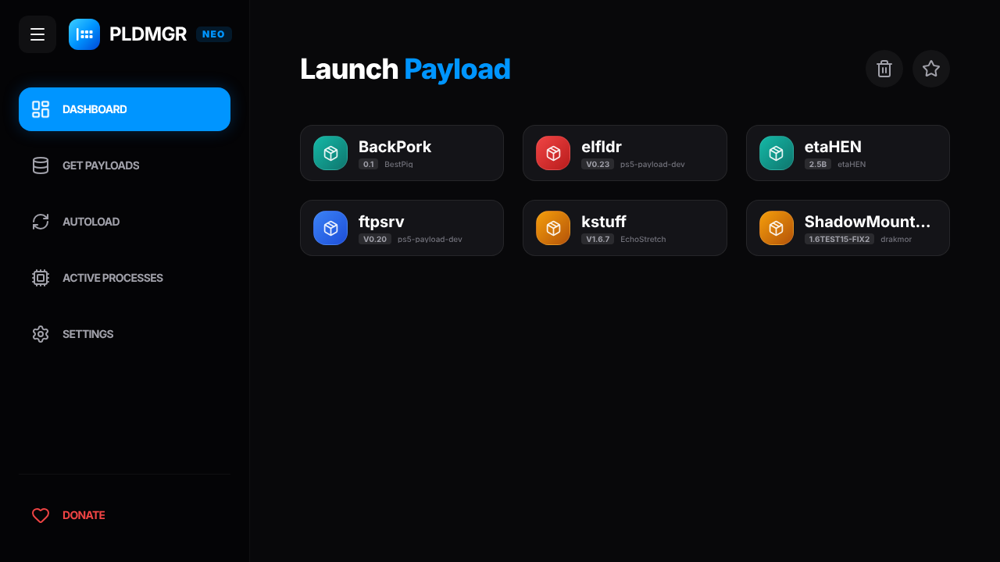

<p align="center">
 
</p>
<h1 align="center">PS5 Payload Manager Neo</h1>

<p align="center">A self-maintaining payload manager for jailbroken PS5 consoles:<br>launch your jailbreak, and your payloads are updated, verified and started for you.</p>

<p align="center">
 
</p>

> **Payload Manager Neo is an independent fork**, maintained by
> [coenflict](https://github.com/coenflict). It is based on
> [PS5 Payload Manager](https://github.com/itsPLK/ps5-payload-manager) by
> [PLK](https://github.com/itsPLK), whose work provides the dashboard, payload
> storage, repositories and autoload that Neo builds on. The features listed
> under [What Neo adds](#what-neo-adds) exist **only in Neo**, not in the
> original Payload Manager. Please report problems with Neo
> [here](https://github.com/coenflict/ps5-payload-manager-neo/issues), not to
> the original project.

## What Neo adds

- **Updates before every launch.** At each start, every payload in your
  autoload list is checked against its maintainer's own release (GitHub,
  Gitea/Forgejo) and the curated catalog. A newer verified version is installed
  before that payload starts, so updates apply to the current boot, not the next
  one.
- **Never blocks a working setup.** No network, a source that is down, a failed
  download or a slow check (bounded by a time budget you choose) simply means
  the installed version is launched.
- **Verified downloads.** Updates must match the published SHA-256 checksum and
  be real PS5 (x86-64 ELF) payloads.
- **Control per payload.** *Safe* (major versions need your approval),
  *Automatic*, *Notify only* or *Off*; prereleases only when you opt in; your
  own upstream repository and release-file pattern when needed.
- **Rollback and crash guard.** The previous version is kept for one-click
  restore. If an updated payload was being launched when the console went down,
  the next start restores the previous version automatically.
- **Keeps itself up to date — as Neo.** Neo updates only from Neo's own
  releases. It never switches to the original Payload Manager or another fork,
  and skips a new build that fails to start.
- **Automatic Updates screen** in Settings, showing what was checked, updated,
  held back or failed.

All details are in [AUTO_UPDATES.md](AUTO_UPDATES.md).

## Features from the original Payload Manager

Inherited from [PS5 Payload Manager](https://github.com/itsPLK/ps5-payload-manager) by PLK:

- **Web-Based Interface**: A modern dashboard to manage payloads from your PC, phone, or the PS5 itself.
- **Import Payloads**: Add payloads from a USB drive or download them from the cloud repository.
- **Automated Startup**: A list of payloads to load automatically whenever the manager starts.
- **Home Screen Shortcut**: Installs a launcher app to your PS5 home screen (shown as *Payload Manager Neo*).
- **Favorites and Process Management**: Keep favorite payloads at hand, inspect active processes, and terminate eligible processes.
- **Custom Repositories**: Add third-party payload repositories ([guide](CUSTOM_REPOSITORIES.md)).
- **Translations**: The interface is available in many languages ([TRANSLATIONS.md](TRANSLATIONS.md)).

## Installation

Download `pldmgr_vX.Y.Z.elf` from this repository's
[Releases](https://github.com/coenflict/ps5-payload-manager-neo/releases) page.

### With WebKit Autoloader (recommended)

The autoloaders by PLK ([WebKit](https://github.com/itsPLK/ps5-webkit-autoloader),
[Y2JB](https://github.com/itsPLK/ps5-y2jb-autoloader),
[BD-JB](https://github.com/itsPLK/ps5-bdjb-autoloader),
[Lua](https://github.com/itsPLK/ps5-lua-autoloader)) start the *original*
Payload Manager by default. To start Neo instead, place it in a
`ps5_autoloader` folder once:

```text
/data/ps5_autoloader/
├── autoload.txt     ← contains one line: pldmgr.elf
└── pldmgr.elf       ← the Neo release, renamed
```

You can put the folder there from your computer with [ps5upload](https://github.com/phantomptr/ps5upload), or copy it from a
USB drive. Step-by-step instructions for both:
[AUTO_UPDATES.md → One-time setup](AUTO_UPDATES.md#one-time-setup-with-webkit-autoloader).
After that, Neo keeps itself and your payloads current.

### Manual loading

You can also send the ELF to an ELF loader on port 9021 like any other payload.

## Documentation

- [AUTO_UPDATES.md](AUTO_UPDATES.md) — Neo's automatic updates, setup and limitations
- [CUSTOM_REPOSITORIES.md](CUSTOM_REPOSITORIES.md) — hosting your own payload catalog
- [TRANSLATIONS.md](TRANSLATIONS.md) — languages and translation help
- [DEVELOPMENT.md](DEVELOPMENT.md) — building, testing and deploying
- [CHANGELOG.md](CHANGELOG.md) — Neo releases and the original project's history

## Credits

- [PLK](https://github.com/itsPLK) — author of [PS5 Payload Manager](https://github.com/itsPLK/ps5-payload-manager), on which Neo is based, the autoloaders and the payloads mirror.
- [Contributors to PS5 Payload Manager](https://github.com/itsPLK/ps5-payload-manager/graphs/contributors).
- [John Törnblom](https://github.com/john-tornblom) — for the [PS5 Payload SDK](https://github.com/ps5-payload-dev/sdk) and homebrew samples used as reference.
- Everyone else contributing to the PS5 homebrew scene.

## Donations

The donation page in the app and [DONATE.md](DONATE.md) support PLK, the
author of the original Payload Manager.

## License

Neo keeps the license of the original project; see [LICENSE](LICENSE).
